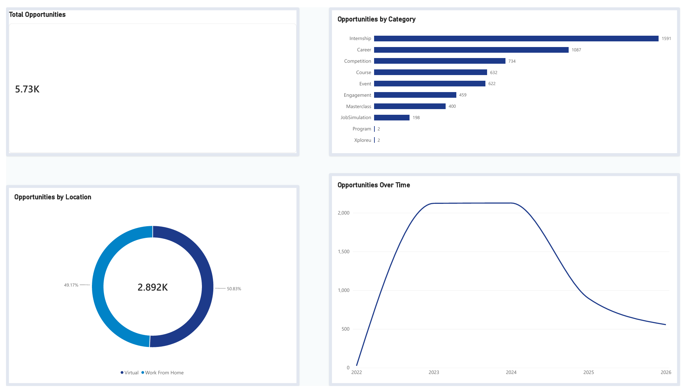

# Executive Opportunity Analytics & Dashboard | Power BI & Python

## 📌 Project Overview
As part of the **Data Visualization Trainee Early Remote Internship at Excelerate**, this project demonstrates an end-to-end Business Intelligence workflow. It transforms raw, unstructured global opportunity datasets (over 5,700 records) into a production-grade, executive decision-making framework.

The project bridges technical data engineering (Python/pandas, Power Query locale remediation) with polished corporate UI/UX design (floating card containers, custom slate-and-navy palettes).

---

## 🛠️ Tech Stack & Tools
- **Data Engineering & Cleaning:** Python (`pandas`, `numpy`, `openpyxl`)
- **Data Transformation & Modeling:** Power BI Desktop, Power Query (M Language)
- **Visualization & UI/UX:** Power BI (Custom Container Layout, High-Contrast Design System)

---

## 📅 Project Roadmap & Deliverables

### Week 1: Data Understanding, Hygiene & Documentation
- **Data Dictionary:** A structured catalog mapping all 33 variables, identifying data types, non-null counts, and sparsity patterns.
- **Data Cleaning Report:** Formal documentation detailing data quality issues (constant columns, HTML tag pollution, missing values) and justification for cleaning steps.
- **Python Cleaning Pipeline (`clean_data.py`):** Automated script handling redundant column removal (`pk`), row validation, type casting (`fee`, `duration`), and missing flag defaults (`is_archived`).

### Week 2: Executive UI/UX Architecture & Visual Analytics
- **Locale Date Parsing:** Resolved critical timestamp hurdles in `created_at` using Power Query Locale Conversions (`English - United States`), unlocking native Power BI Date Hierarchies (`Year → Quarter → Month → Day`) across a 2022–2026 horizon.
- **Executive Design System:** Engineered a custom 4-quadrant floating card layout using a soft neutral canvas (`#F8FAFC`), pure white cards (`#FFFFFF`), subtle borders (`#E2E8F0`), and soft drop shadows.

---

## 📊 Dashboard Architecture & Core Insights

| Dashboard Quadrant | Visual Type | Primary Metric / Breakdown | Strategic Takeaway |
| :--- | :--- | :--- | :--- |
| **Top-Left** | KPI Card | **5.73K Total Opportunities** | Establishes the total dataset baseline volume across all program channels. |
| **Top-Right** | Horizontal Bar Chart | **Internships (1,591) & Career (1,087)** | Core experiential career listings account for over **46%** of total demand. |
| **Bottom-Left** | Donut Chart | **50.83% Work From Home vs. 49.17% Virtual** | Near-equal split across remote delivery models, confirming balanced engagement. |
| **Bottom-Right** | Line Chart | **Multi-Year Trend (2022–2026)** | Sharp volume acceleration peaking across 2023–2024 (~2,100 listings/yr) before stabilizing. |

---

## 🚀 Repository Files
- `clean_data.py`: Automated Python cleaning pipeline.
- `Cleaned_Opportunity_Dataset.xlsx`: Cleaned dataset generated from Python processing.
- `Opportunities_Dashboard.pbix`: Interactive Power BI dashboard file.
